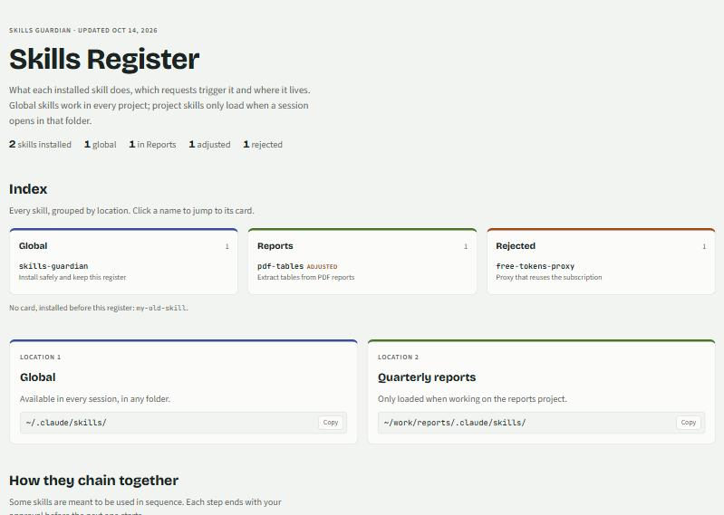
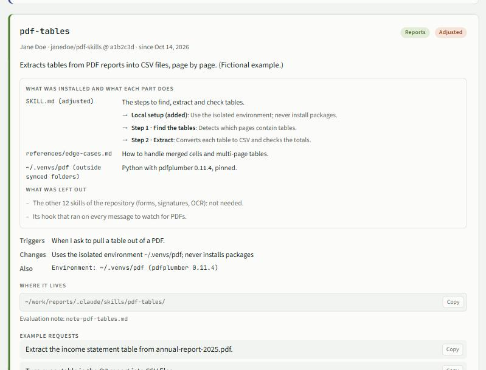

# Skills Guardian

[](https://github.com/mateobarra2003-ctrl/Skills-Guardian/actions/workflows/tests.yml)
[](LICENSE)

[English](README.md) · **Español**

Una skill de [Claude Code](https://code.claude.com) que hace que Claude **revise skills, plugins y
servidores MCP antes de instalarlos**, y lleva un registro HTML local de qué instalaste, qué dejaste
afuera y por qué.



## Por qué

Una skill es un conjunto de instrucciones que Claude obedece como si las hubieras escrito tú. Un
plugin además puede ejecutar código por su cuenta (hooks), y un servidor MCP puede ver tus datos.
Las skills circulan por videos y redes sociales, y la mayoría de la gente las instala sin leerlas.

Skills Guardian hace que Claude se detenga y revise primero. No te bloquea: te dice qué es
realmente, qué haría en tu computadora, cómo afectaría a tus proyectos, y solo la instala cuando
dices que sí.

## Qué hace

- **Un protocolo de 7 pasos antes de cada instalación.** Claude identifica a qué apunta realmente
  el link, revisa el autor y el código (sobre todo lo que se ejecuta solo), escribe una nota de
  evaluación, propone dónde y cómo instalarla, espera tu "sí", instala y verifica la copia, y
  actualiza tu registro.
- **Instalaciones selectivas.** De un paquete de cientos de skills, solo las que necesitas. Los
  hooks y los autoinstaladores quedan afuera cuando las skills funcionan sin ellos. Los programas
  pesados van en entornos aislados y con versión fijada.
- **Notas de evaluación** en Markdown, una por revisión, con cómo afectaría a cada uno de tus proyectos.
- **Una página de registro** que abres en tu navegador:
  - un índice de todas las skills, agrupadas por ubicación (global o por proyecto);
  - una ficha por skill con qué se instaló, para qué sirve cada parte, qué quedó afuera, cuándo
    se activa, pedidos de ejemplo y un botón para copiar el pedido "explícame esta skill en detalle";
  - lo descartado, con sus razones;
  - una descripción del protocolo, para quien vea la página.
- **Una auditoría** que avisa si hay skills instaladas sin pasar por el protocolo.
- **Español e inglés.** Claude responde en tu idioma; las etiquetas de la página siguen el idioma
  del registro.



## Instalación

Requisitos: Claude Code, Python 3.9 o superior (solo la librería estándar) y git (para revisar
repositorios).

Como corresponde, conviene leer [`SKILL.md`](skills/skills-guardian/SKILL.md) antes de instalarla.
Skills Guardian **no tiene hooks, ni servidor MCP, ni comandos automáticos**. Su único script se
ejecuta cuando Claude lo llama, y solo toca los archivos del registro.

**Opción A: como plugin de Claude Code**

```
/plugin marketplace add mateobarra2003-ctrl/Skills-Guardian
/plugin install skills-guardian@skills-guardian
```

**Opción B: copiar la carpeta** (queda disponible en todos los proyectos)

macOS / Linux:

```bash
git clone --depth 1 https://github.com/mateobarra2003-ctrl/Skills-Guardian.git
cp -r Skills-Guardian/skills/skills-guardian ~/.claude/skills/
```

Windows (PowerShell):

```powershell
git clone --depth 1 https://github.com/mateobarra2003-ctrl/Skills-Guardian.git
Copy-Item -Recurse Skills-Guardian\skills\skills-guardian "$HOME\.claude\skills\"
```

**Opción C: con el CLI de skills**

```bash
npx skills add mateobarra2003-ctrl/Skills-Guardian
```

Después abre una sesión **nueva** de Claude Code: las skills se cargan al iniciar.

## Primer uso

Pídele a Claude algo como *"Configura Skills Guardian"*, o directamente *"¿Es segura esta skill?
https://github.com/…"*. La primera vez, Claude:

1. crea tu registro en `~/.claude/skills-guardian/` (u otra carpeta que elijas);
2. pregunta en qué idioma quieres la página;
3. pregunta brevemente por tus proyectos, para que cada evaluación diga cómo los afecta;
4. lista las skills que ya tenías, para que las evalúes más adelante.

Abre `~/.claude/skills-guardian/registry.html` en tu navegador para ver el registro.

## Ejemplos

- *"Vi esta skill en un video. ¿Es segura? https://github.com/alguien/skills-geniales"*
- *"Instala solo las skills de PDF de este repo, en mi proyecto de informes."*
- *"Desinstala pdf-tables y actualiza mi registro."*
- *"Audita mis skills: ¿hay algo instalado que no pasó por el guardián?"*
- *"Install this skill: https://github.com/…"* (también funciona en inglés)

## Dónde vive cada cosa

| Qué | Ubicación por defecto |
|---|---|
| La skill | `~/.claude/skills/skills-guardian/` (o la carpeta del plugin) |
| Registro (datos) | `~/.claude/skills-guardian/registry.json` |
| Página del registro | `~/.claude/skills-guardian/registry.html` |
| Notas de evaluación | `~/.claude/skills-guardian/notes/` |

Para guardarlos en otro lado (por ejemplo, una carpeta de documentos), Claude ejecuta
`registry.py init --home <carpeta>` y un pequeño `~/.claude/skills-guardian/config.json` apunta ahí.

El script también se puede usar directamente:

| Comando | Qué hace |
|---|---|
| `python3 scripts/registry.py where` | Muestra el registro, la página y las notas en uso |
| `python3 scripts/registry.py init --language es` | Crea un registro nuevo |
| `python3 scripts/registry.py update` | Valida el registro y reconstruye la página |
| `python3 scripts/registry.py audit` | Compara las skills en disco con el registro |
| `python3 scripts/registry.py compare ORIGEN DESTINO` | Compara dos carpetas archivo por archivo |

El formato del registro está en
[`references/registry-format.md`](skills/skills-guardian/references/registry-format.md), y
[`examples/registry-example.json`](examples/registry-example.json) es un ejemplo completo.

## Privacidad y límites

- **Todo queda en tu computadora.** El registro, las notas y la página son archivos locales. No se
  sube nada salvo que decidas publicar la página tú mismo.
- **Sin telemetría.** Solo hay acceso a la red durante una revisión que pediste: la API de GitHub,
  un `git clone` del repositorio que se revisa, o una búsqueda opcional con `npx skills find` con la
  telemetría apagada.
- **Reduce el riesgo; no lo elimina.** Una revisión es una lectura cuidadosa asistida por una IA, no
  una garantía. Claude dice qué no revisó, y la última palabra siempre es tuya.

## Desinstalar

- Plugin: `/plugin uninstall skills-guardian@skills-guardian`
- Carpeta copiada: borrar `~/.claude/skills/skills-guardian/`
- Tus datos: borrar `~/.claude/skills-guardian/` (solo si ya no quieres el registro)

## Contribuir

Los issues y pull requests son bienvenidos. Para correr los tests:

```bash
python -m unittest discover -s tests -v
```

Para agregar un idioma, suma sus textos a `TEXT` en
[`scripts/registry.py`](skills/skills-guardian/scripts/registry.py) y a `T` en
[`assets/registry-template.html`](skills/skills-guardian/assets/registry-template.html).
Para informar un problema de seguridad, mira [SECURITY.md](SECURITY.md).

## Licencia

[MIT](LICENSE). Skills Guardian empezó como una skill personal para revisar skills encontradas en
redes sociales, y se generalizó para que cualquiera pueda usarla.
